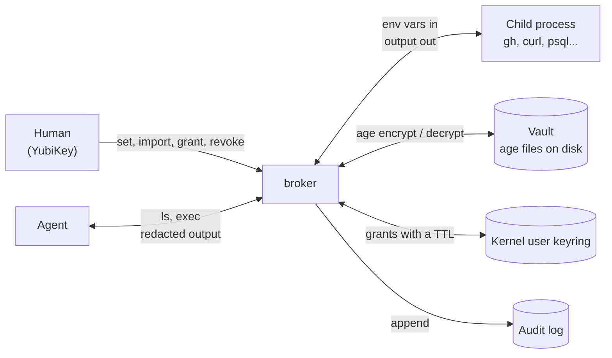
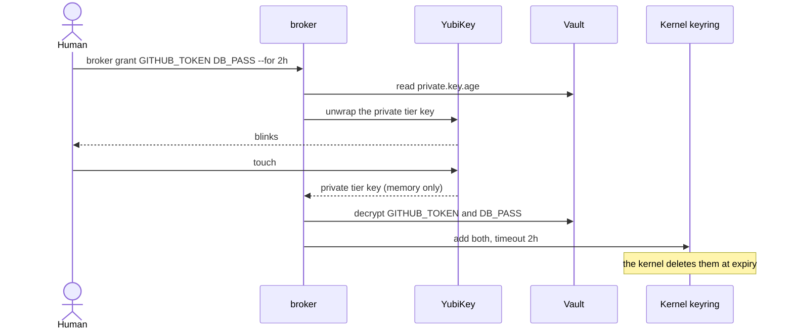
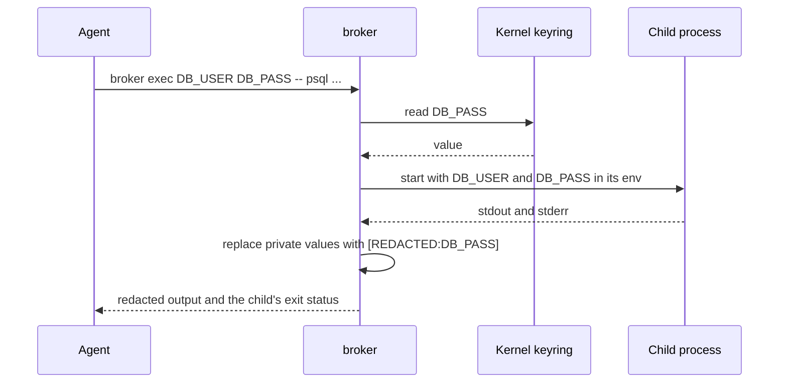
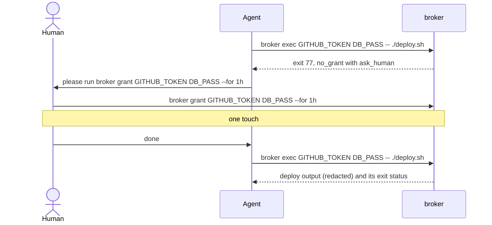
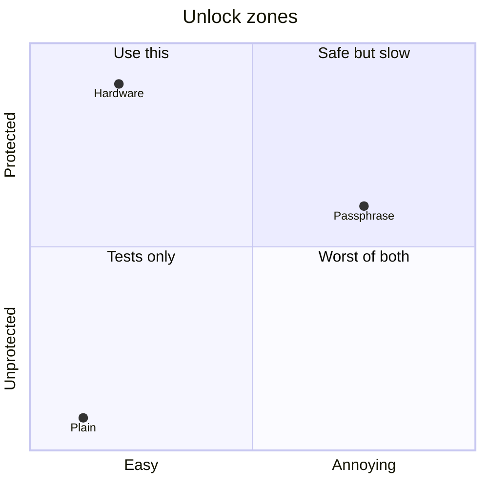
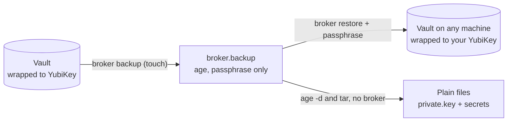

# Credential Broker

A local secret store for a machine where AI agents do most of the typing. Agents run commands **with** your secrets and never see them. You authorize with a YubiKey touch, and the kernel forgets the grant when it expires.

```sh
broker ls --json                                 # agent: what secrets exist (names, never values)
broker exec GITHUB_TOKEN -- gh repo list         # agent: run a command with one
broker grant GITHUB_TOKEN --for 2h               # you: one touch when the agent asks
```

There's no server, no daemon, and no account. Secrets are plain [age](https://age-encryption.org) files on disk, grants live in the Linux kernel keyring with a timeout, and every read lands in an audit log with the process tree that asked for it.

v1 was a client/server broker for teams, with users, scopes, and PGP challenges. v2 is a from-scratch rewrite for one person and the agents working on their machine. The full spec is in [DESIGN.md](./DESIGN.md).

## Why not ~/.zshenv

My tokens used to live in `~/.zshenv`, one `export` per line. That file gets sourced into every shell, which means every agent session starts with every token I own sitting in its environment. One `env`, one `printenv` in a debug step, one stack trace that dumps the environment, and a token is in a transcript that gets uploaded somewhere. Nobody has to be malicious for that to happen.

broker flips it around. Nothing is ambient: a secret only exists in the environment of the one command that needs it, for as long as that command runs, and private values get scrubbed from its output before the agent reads it.

## How it works



Secret names are environment variable names (`GITHUB_TOKEN`, `DB_PASS`), and `exec` exports them under that name. Each secret can carry a one-line description so an agent can figure out which one it needs.

### Tiers

Every secret is in one of two tiers.

| | `private` (default) | `public` |
|---|---|---|
| `exec` | needs a live grant | always works |
| `get` | fresh touch every time | prints at once |
| redacted from `exec` output | yes | no |

`public` is for things that aren't really secret but are handy to keep in one place: usernames, hostnames, low-risk tokens. Everything else is `private`.

Writing a private secret only needs the tier's public key, so `set` and `import` never ask for a touch. Only reading does.

### Grants

A grant is you saying "agents can use these for the next two hours." One touch unwraps the private tier key in memory, broker decrypts just the named secrets, and each one goes into the kernel user keyring with a timeout. The key itself is never cached. When the timeout hits, the kernel drops the secret; there's no daemon to forget to stop.



The default duration is `1h` (`default_grant` in `~/.config/broker/config.json`) and the max is `24h` unless you pass `--force`. `broker revoke` drops grants early.

### exec and redaction

`exec` pulls public secrets from disk and private ones from the keyring, starts the command with them in its environment, and passes stdin, signals, and the exit status straight through. Values never go in argv and never touch disk.

When the command's stdout or stderr isn't a terminal (the agent case), broker streams it through a redactor that swaps every private value for `[REDACTED:NAME]`, including values split across reads. When it is a terminal (you), output passes through untouched so interactive tools keep working.



```console
$ broker exec DB_USER DB_PASS -- sh -c 'echo "user=$DB_USER pass=$DB_PASS"' | cat
user=nate pass=[REDACTED:DB_PASS]
```

### When there's no grant

Agents never do auth. If a private secret isn't granted, `exec` refuses before running anything, exits 77, and prints one JSON line telling the agent exactly what to ask you for. Multiple missing names come back as a single ask, so it's one touch.

```console
$ broker exec GITHUB_TOKEN DB_PASS -- ./deploy.sh
{"error":"no_grant","names":["GITHUB_TOKEN","DB_PASS"],"ask_human":"broker grant GITHUB_TOKEN DB_PASS --for 1h"}
```



Every failure an agent can hit has a stable `error` code. The full table is in the [agent skill](./skills/broker/SKILL.md).

## Install

Linux only (see [Linux and sandboxes](#linux-and-sandboxes)). You need Go to build it, plus [age-plugin-yubikey](https://github.com/str4d/age-plugin-yubikey) and `pcscd` for the YubiKey. The stock `age` CLI is optional but worth having for [recovery](#recovering-without-broker).

```sh
sudo pacman -S age pcsclite ccid       # or your distro's equivalent
sudo systemctl enable --now pcscd
cargo install age-plugin-yubikey       # or the AUR package
```

Build from source (the binaries on the Releases page are still v1):

```sh
git clone https://github.com/NathanielInman/credential-broker
cd credential-broker
go build -o ~/.local/bin/broker .
```

### Agent skill

The repo ships a skill at [skills/broker/SKILL.md](./skills/broker/SKILL.md) that triggers on any task needing a token or credential. It tells the agent to find secrets with `broker ls --json`, run commands with `broker exec`, stop on exit 77 and hand you the `ask_human` command verbatim, and treat `[REDACTED:NAME]` as expected. Symlink it so it tracks the repo:

```sh
mkdir -p ~/.claude/skills
ln -s "$PWD/skills/broker" ~/.claude/skills/broker   # from the repo root
```

## Unlock strength

The private tier key is wrapped to one or more **unlock identities**, and those decide how safe the vault really is. broker sorts them into three zones and prints the vault's zone at `init` and `restore`. Any one unlock opens the private tier, so a vault is only as strong as its weakest unlock.



| | hardware | passphrase | plain |
|---|---|---|---|
| unlock identity | YubiKey 5 over PIV (`age-plugin-yubikey`) | identity file encrypted with `age -p` | `AGE-SECRET-KEY` file |
| each grant costs | a touch | typing the passphrase | nothing |
| on disk | a stub that's useless without the key | scrypt-encrypted key | a key anything running as you can read |
| agent fakes a terminal and runs `grant` | blocked, nobody touched | blocked, it doesn't know the passphrase | works |
| the human secret leaks | a PIN alone opens nothing | anyone can unlock, forever | n/a |

Hardware is the only zone where the key can't leave the device, so it's the only one where a leaked PIN isn't enough. A passphrase is the stop-gap for a machine without a YubiKey. It holds up at rest if it's long (let `age -p` generate one), but once it leaks it's done. Plain is for tests.

Two things look like they belong in between and don't. A U2F-only key (older Titan keys: `fido2-token -I` shows `nocbor`) can't derive a key, so it could only be a check inside broker, and anything that reads the vault files directly walks right around a check. A touch on top of a passphrase sounds stronger but isn't, because the passphrase alone still decrypts the file. broker offers neither.

## Setup

Pick a zone, make the identity file, and point `init` at it.

**Hardware.** Make an age identity on the YubiKey. The plugin is interactive: pick a new PIV slot, touch policy "always" (or "cached" if you want 15 seconds of grace), and PIN policy "once".

```sh
age-plugin-yubikey
mkdir -p ~/.config/broker
age-plugin-yubikey --identity > ~/.config/broker/yubikey-identity.txt
broker init --identity ~/.config/broker/yubikey-identity.txt
```

That file is a stub that points at the hardware, not a key. Got a spare YubiKey? Repeat `--identity` for each one and either can unlock the vault.

**Passphrase.** Press Enter at age's prompt and it generates a 10 word passphrase for you. Write it down.

```sh
mkdir -p ~/.config/broker
age-keygen | age -p -o ~/.config/broker/passphrase-identity.age
broker init --identity ~/.config/broker/passphrase-identity.age
```

`init` asks for the passphrase once to read the identity, then `grant`, a private `get`, and `backup` ask every time. Keep the file: the passphrase opens nothing without it. You can add it next to a YubiKey as a spare (broker tries the hardware first and only asks for the passphrase when that fails), but remember that drops the whole vault to the passphrase zone.

**Plain.** A plain `age-keygen` key with `--insecure-plain-identity`. This is what the tests use.

Then store things. `set` reads the value from a hidden prompt (or stdin with `--stdin`), and new secrets are private:

```sh
broker set GITHUB_TOKEN --desc "GitHub API, repo scope"
broker set DB_USER --public --desc "Postgres user for the dev db"
broker ls
```

```
NAME          TIER     GRANT  DESCRIPTION
DB_USER       public   -      Postgres user for the dev db
GITHUB_TOKEN  private  -      GitHub API, repo scope
```

## Moving off ~/.zshenv

`import` reads `export NAME=value` and `NAME=value` lines, stores them, and tells you which lines are now safe to delete. It never prints values and never edits the file. Anything the shell would have to work out (`$VAR`, `$(cmd)`, `~`) is skipped and reported, and so is anything still referenced by a line that stays behind. Start with a dry run:

```console
$ broker import ~/.zshenv --dry-run
would import (3):
  GITHUB_TOKEN    private  line 3
  OPENAI_API_KEY  private  line 4
  DB_HOST         private  line 5
skipped (2):
  line 2  PATH    variable reference
  line 6  DB_URL  variable reference
kept, still used in /home/nate/.zshenv (1):
  line 5  DB_HOST  used on line 6
after import, safe to delete from /home/nate/.zshenv: lines 3-4
```

Then for real, then delete the listed lines yourself and open a new shell:

```sh
broker import ~/.zshenv
cp ~/.zshenv ~/.zshenv.bak && sed -i '3,4d' ~/.zshenv
```

Everything imports as private unless you pass `--public`. To move a low-risk value to the public tier afterwards, set it again with `broker set DB_HOST --public` (it asks for the value). `--overwrite` replaces names already in the vault.

## Backup and restore

The vault is wrapped to your YubiKey, so losing the key loses the vault. `backup` writes the whole thing (with the private tier key unwrapped, one touch) into a single file encrypted with a passphrase alone:

```sh
broker backup -o ~/broker.backup --generate-passphrase
```

`--generate-passphrase` prints 7 diceware words (about 90 bits) on stderr; write them down somewhere offline. Without it you type your own. The file is safe to keep anywhere (git, a NAS, R2), but its only protection is that passphrase and offline guessing has no rate limit.

`restore` rebuilds the vault and wraps it to your YubiKey again, either the identities stored in the backup (same YubiKey, new machine) or new ones with `--identity`. It refuses to replace an existing vault without `--force`, and it never leaves you with half a vault.

```sh
broker restore ~/broker.backup
broker restore ~/broker.backup --identity ~/.config/broker/new-yubikey.txt --force
```



### Recovering without broker

A backup is an age file holding a tar laid out like the vault directory, so the stock tools get everything back even if this project disappears:

```sh
mkdir restored
age -d ~/broker.backup | tar -x -C restored      # asks for the passphrase
age -d -i restored/data/private.key restored/data/secrets/private/GITHUB_TOKEN.age
age -d -i restored/data/public.key  restored/data/secrets/public/DB_USER.age
cat restored/data/secrets/private/GITHUB_TOKEN.json   # description and dates
rm -rf restored                                   # it's all plaintext keys, clean up
```

## The audit log

Every command except `ls` and `log` appends a line to `~/.local/state/broker/log.jsonl`, failures included, with the process chain that ran it. A denied `no_grant` is usually the most interesting line in there: it tells you which agent wanted what.

```console
$ broker log --since 24h --name DB_PASS
TIME                 ACTION  RESULT    TIER     NAMES                 DETAIL       FROM
2026-10-21 21:48:45  set     ok        private  DB_PASS               -            zsh < alacritty < systemd
2026-10-21 21:48:45  exec    no_grant  private  GITHUB_TOKEN,DB_PASS  ./deploy.sh  bash < claude < zsh < alacritty < systemd
2026-10-21 21:48:45  grant   ok        private  GITHUB_TOKEN,DB_PASS  for 2h       zsh < alacritty < systemd
2026-10-21 21:48:45  exec    ok        private  GITHUB_TOKEN,DB_PASS  ./deploy.sh  bash < claude < zsh < alacritty < systemd
```

`--json` prints the raw lines. Values are never logged.

## Threat model

broker is built against **accidental leaks**: tokens ending up in transcripts, logs, committed files, CI output, or a shell environment every process inherits. Against that it does well. Secrets aren't ambient, agents only ever hold the output of a command, private values are redacted from that output, grants expire on their own, and the log shows who asked.

It does not protect against:

- **A hostile agent holding a live grant.** Any process running as your user can read a granted secret from the keyring, or run `exec` and send the value somewhere instead of printing it. Grants are short for a reason.
- **Files the child writes.** Redaction covers the child's stdout and stderr only. If the command writes the token to a file, it's in the file.
- **Transformed values.** The redactor matches exact bytes. A value that comes out base64'd, URL-encoded, or wrapped across two lines isn't caught. Values shorter than 6 bytes aren't redacted at all.
- **A plain vault.** broker refuses human commands without a terminal, but `script` fakes one in a single line, so on a plain vault an agent can grant itself anything. The touch or the passphrase is what proves a human was there.
- **A leaked passphrase.** In the passphrase zone it's all it takes, from any machine that has the identity file.
- **Public secrets.** They're not redacted, by design. Don't put anything in `public` you'd mind seeing in a transcript.
- **Root, or anything that already owns your user.** It can read process memory, the keyring, and your terminal.
- **A weak backup passphrase.** Use the generated one.

## Linux and sandboxes

v2 is Linux only, because grants are kernel keyring entries. Other platforms compile but every command says "unsupported platform". A macOS port on top of Keychain and `age-plugin-se` is the obvious next step, but it doesn't exist yet.

The kernel user keyring is per uid, so a grant made in your terminal is visible to agents in other sessions. It's also per **user namespace**, though, and that bites: anything running under bubblewrap or flatpak (and agent sandboxes built on them) gets its own empty user keyring and sees no grants at all.

```console
$ bwrap --dev-bind / / broker exec GITHUB_TOKEN -- true
{"error":"no_grant","names":["GITHUB_TOKEN"],"ask_human":"broker grant GITHUB_TOKEN --for 1h"}
```

Granting again won't fix it. `broker exec` has to run outside the sandbox, so allow it as an unsandboxed command in your agent's config. The skill tells agents to recognize this and ask.

## Commands

Grouped as in `broker --help`. Every command takes `--help` for the details.

### Human commands

```sh
broker backup -o FILE                     # Write a passphrase-encrypted copy of the vault
              [--generate-passphrase] [--include-log]
broker get NAME                           # Print a secret (private needs a fresh touch)
broker grant NAME... | --all              # Let exec use private secrets for a while (one touch)
             [--for DUR] [--force]
broker import FILE [--public]             # Move NAME=value lines from a shell env file into the vault
             [--overwrite] [--dry-run]
broker init --identity FILE...            # Create the vault, wrapped to one or more unlock identities
            [--insecure-plain-identity]
broker log [--since DUR] [--name NAME]    # Show the audit log
           [--json]
broker restore FILE [--identity FILE...]  # Rebuild the vault from a backup
               [--insecure-plain-identity] [--force]
broker revoke NAME... | --all             # Drop grants before they expire
broker rm NAME                            # Delete a secret
broker set NAME [--public|--private]      # Store a secret from a hidden prompt or stdin
           [--desc TEXT] [--stdin]
```

### Agent commands (never prompt)

```sh
broker exec NAME... -- CMD [ARGS...]      # Run CMD with secrets in its environment, redacting its output
broker ls [--json]                        # List secrets, tiers, descriptions, and grants (never values)
```

If an agent runs something that needs a prompt or a touch (`set` without `--stdin`, `grant`, a private `get`, `backup`, `restore`), it fails at once with `needs_human` and the exact command to hand you, instead of waiting on a prompt nobody will answer.

Files live under the XDG directories: `~/.config/broker`, `~/.local/share/broker`, and `~/.local/state/broker`. Set `BROKER_HOME` to put all three under one directory instead. How it all fits together (key wrapping, the keyring layout, the redactor, the backup format) is in [DESIGN.md](./DESIGN.md).
