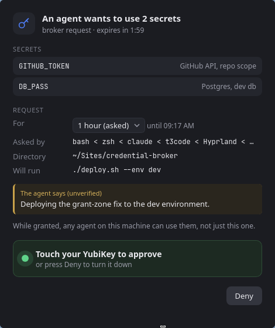
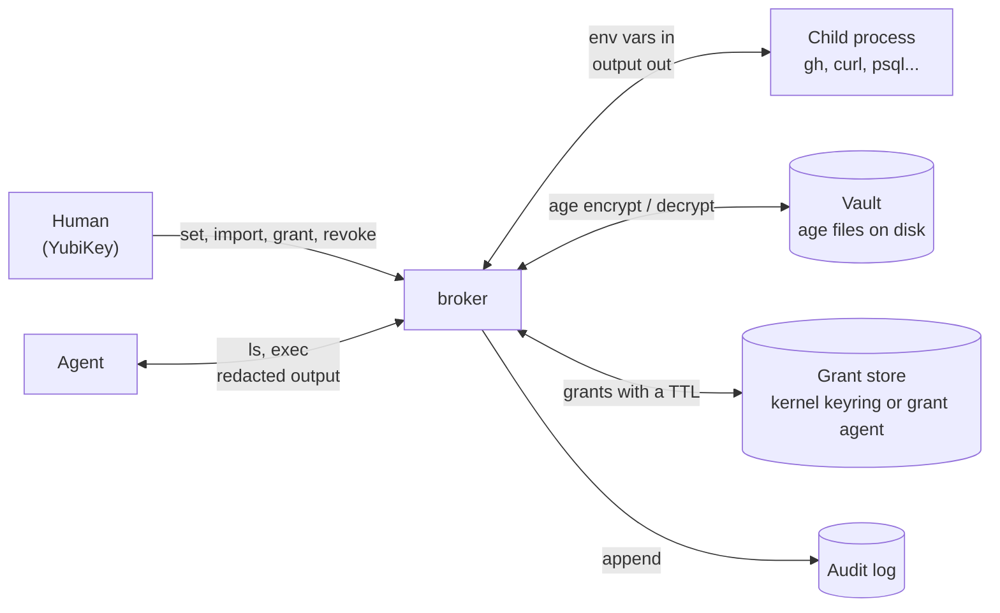
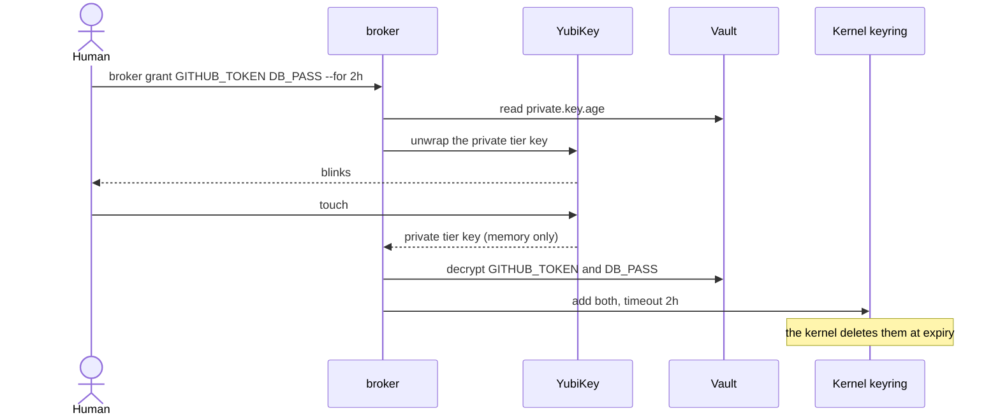
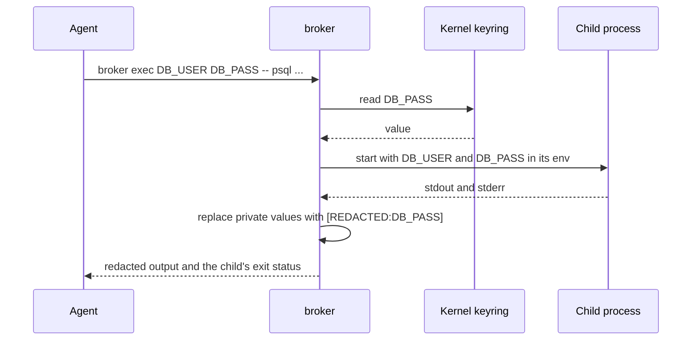
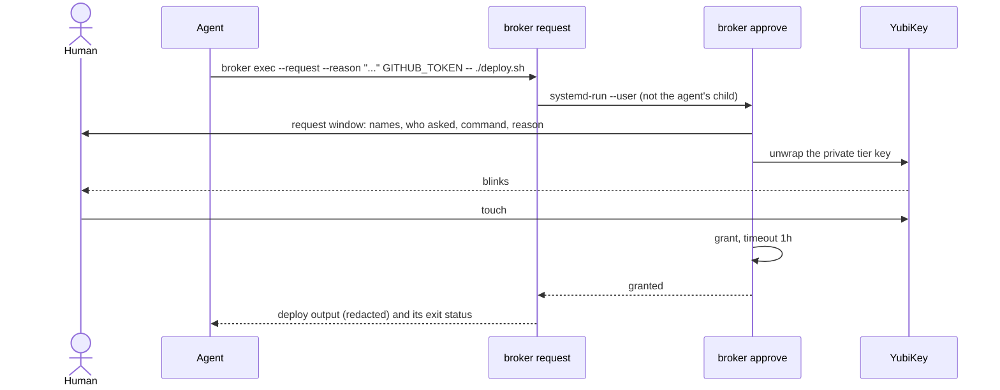
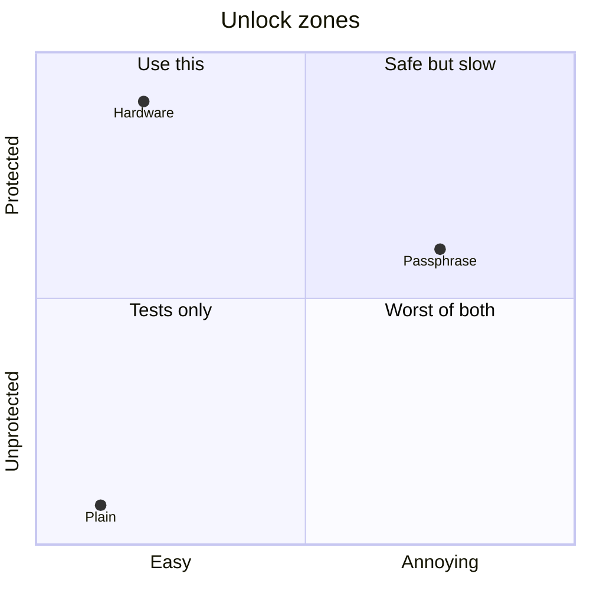
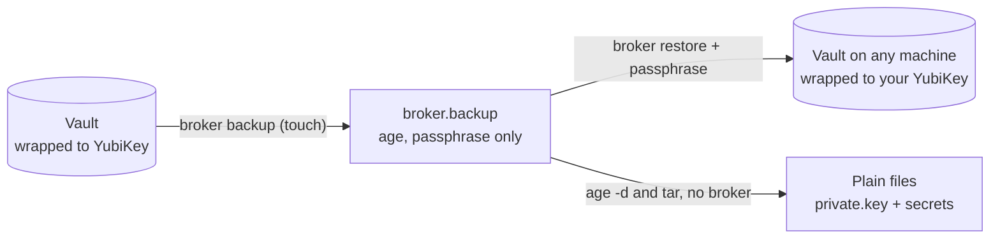

# Credential Broker

A local secret store for a machine where AI agents do most of the typing. Agents run commands **with** your secrets and never see them. When one needs a secret, this pops up on your desktop:

<p align="center">
  
</p>

You touch your YubiKey (or Touch ID on a Mac), the command runs, and the grant is forgotten an hour later. That's the whole human side. The agent's side is two commands:

```sh
broker ls --json        # what secrets exist (names and descriptions, never values)
broker exec --request --reason "Deploying the grant-zone fix to the dev environment." \
  GITHUB_TOKEN DB_PASS -- ./deploy.sh --env dev
```

Prefer a terminal? `broker grant GITHUB_TOKEN DB_PASS --for 1h` does the same thing without the window.

There's no server, no daemon, and no account. Secrets are plain [age](https://age-encryption.org) files on disk, grants live in memory with a timeout (the kernel keyring on Linux, plus a small in-memory agent for sandboxes; that agent alone on macOS and Windows), and every read lands in an audit log with the process tree that asked for it.

v1 was a client/server broker for teams, with users, scopes, and PGP challenges. v2 is a from-scratch rewrite for one person and the agents working on their machine. The full spec is in [DESIGN.md](./DESIGN.md).

## Why not ~/.zshenv

My tokens used to live in `~/.zshenv`, one `export` per line. That file gets sourced into every shell, which means every agent session starts with every token I own sitting in its environment. One `env`, one `printenv` in a debug step, one stack trace that dumps the environment, and a token is in a transcript that gets uploaded somewhere. Nobody has to be malicious for that to happen.

broker flips it around. Nothing is ambient: a secret only exists in the environment of the one command that needs it, for as long as that command runs, and private values get scrubbed from its output before the agent reads it.

## How it works



Secret names are environment variable names (`GITHUB_TOKEN`, `DB_PASS`), and `exec` exports them under that name. Each secret can carry a one-line description so an agent can figure out which one it needs.

### Tiers

Every secret is in one of two tiers.

| | `private` (default) | `public` |
|---|---|---|
| `exec` | needs a live grant | always works |
| `get` | fresh touch every time | prints at once |
| redacted from `exec` output | yes | no |

`public` is for things that aren't really secret but are handy to keep in one place: usernames, hostnames, low-risk tokens. Everything else is `private`.

Writing a private secret only needs the tier's public key, so `set` and `import` never ask for a touch. Only reading does.

### Grants

A grant is you saying "agents can use these for the next two hours." One touch unwraps the private tier key in memory, broker decrypts just the named secrets, and each one goes into the kernel user keyring with a timeout. The key itself is never cached. When the timeout hits, the kernel drops the secret; there's no daemon to forget to stop.

macOS and Windows have no kernel keyring, so there the first grant starts `broker grantd`, a small agent that holds grants in memory only, drops each one on a timer, answers only your user over a private unix socket, and exits once it has held nothing for 30 seconds. Nothing granted ever touches disk, and logging out or rebooting forgets everything. On Linux every grant goes to that agent too, so agents in a sandbox can see it (see [Platforms](#platforms)).



The default duration is `1h` (`default_grant` in `~/.config/broker/config.json`) and the max is `24h` unless you pass `--force`. `broker revoke` drops grants early.

### exec and redaction

`exec` pulls public secrets from disk and private ones from the keyring, starts the command with them in its environment, and passes stdin, signals, and the exit status straight through. Values never go in argv and never touch disk.

When the command's stdout or stderr isn't a terminal (the agent case), broker streams it through a redactor that swaps every private value for `[REDACTED:NAME]`, including values split across reads. When it is a terminal (you), output passes through untouched so interactive tools keep working.



```console
$ broker exec DB_USER DB_PASS -- sh -c 'echo "user=$DB_USER pass=$DB_PASS"' | cat
user=nate pass=[REDACTED:DB_PASS]
```

### When there's no grant

Agents never do auth. If a private secret isn't granted, plain `exec` refuses before running anything, exits 77, and prints one JSON line telling the agent exactly what to ask you for.

```console
$ broker exec GITHUB_TOKEN DB_PASS -- ./deploy.sh
{"error":"no_grant","names":["GITHUB_TOKEN","DB_PASS"],"ask_human":"broker grant GITHUB_TOKEN DB_PASS --for 1h"}
```

That works when you have a terminal next to the agent's. In something like T3 you never see the agent's terminal, so `exec --request` (or `broker request` on its own) asks you in the **request window** instead, the one at the [top of this page](#credential-broker).

Everything in the window except the yellow box is something broker worked out itself: the secrets and their descriptions, the process chain and directory (read from `/proc`, not from the agent), and the command it will run. The yellow box is the agent's `--reason`, labeled as its word. You can pick a shorter duration before approving. What approving takes depends on the [unlock zone](#unlock-strength): touch the key on a hardware vault, type the passphrase into the window on a passphrase vault, or click Approve on a plain one. Deny, Escape, or closing the window all say no, and the agent gets `denied` and is told not to ask again. Nobody answering within 2 minutes gets it `request_timeout`.



The approver holds the unwrapped private tier key, so nothing else may read its memory. On Linux a process can read the memory of its own descendants (`kernel.yama.ptrace_scope=1`), so `request` starts the approver through `systemd-run --user`, as a child of your service manager, and the approver marks itself non-dumpable the way ssh-agent does. On macOS the hardened runtime does that job (see [Install](#install)), and the approver also refuses debugger attachment. On Windows the approver and grant agent lock their own process DACL, so other processes of yours can't open them to read memory; an administrator still can. That also keeps the window up if the agent's shell command times out: approve anyway and the agent's next `exec` finds the grant. One window shows at a time; a second request waits behind it, and usually finds its names granted by the time it gets a turn.

If there's no desktop session or broker-dialog isn't installed, `--request` falls back to the plain `no_grant` line above.

Every failure an agent can hit has a stable `error` code. The full table is in the [agent skill](./skills/broker/SKILL.md).

## Install

Linux, macOS, or Windows (see [Platforms](#platforms)). The stock `age` CLI is optional but worth having for [recovery](#recovering-without-broker).

Download the archive for your platform from [Releases](https://github.com/NathanielInman/credential-broker/releases/latest) and put `broker` and `broker-dialog` together on your `PATH` (`~/.local/bin` works). The Linux builds need GTK 3 and WebKitGTK 4.1 installed; the macOS build is universal and already signed with the hardened runtime. A browser download on macOS is quarantined and Gatekeeper refuses it, so clear that once:

```sh
xattr -d com.apple.quarantine broker broker-dialog
```

Or build from source with Go:

```sh
git clone https://github.com/NathanielInman/credential-broker
cd credential-broker
go build -o ~/.local/bin/broker .
(cd broker-dialog && go build -o ~/.local/bin/broker-dialog .)
```

`broker-dialog` is the request window. It's a separate program so broker itself stays pure Go with nothing to link, and it goes next to `broker`. On Windows the commands differ a little; see below.

### Linux

The window needs GTK 3 and WebKitGTK 4.1, and a YubiKey needs [age-plugin-yubikey](https://github.com/str4d/age-plugin-yubikey), `pcscd`, and `ykman` to set it up:

```sh
sudo pacman -S age gtk3 webkit2gtk-4.1 pcsclite ccid age-plugin-yubikey yubikey-manager
sudo systemctl enable --now pcscd.socket
# Debian/Ubuntu: libgtk-3-dev libwebkit2gtk-4.1-dev pcscd yubikey-manager, then cargo install age-plugin-yubikey
```

On Arch, `packaging/aur/credential-broker-bin` packages the release build (both binaries, GTK and WebKitGTK as dependencies, the YubiKey tools as optional ones). Until it's on the AUR, install it from a clone:

```sh
cd packaging/aur/credential-broker-bin && makepkg -si
```

The window has a fixed size, which Hyprland and most tiling compositors already float. Its Wayland app id is `broker` if you want a rule anyway (`windowrulev2 = float, class:^(broker)$`).

### macOS

The window uses the system's WebKit, so there's nothing to install for it. For Touch ID, get [age-plugin-se](https://github.com/remko/age-plugin-se), which keeps the key in the Mac's Secure Enclave. A YubiKey works too, with no `pcscd` needed:

```sh
brew install age age-plugin-se          # and age-plugin-yubikey ykman for a YubiKey
codesign --force --sign - --options runtime ~/.local/bin/broker ~/.local/bin/broker-dialog
```

The `codesign` line (for builds from source; release builds come signed) matters. It turns on the hardened runtime, under which no other process of yours can attach to broker or read its memory, and that's what protects the approver and the grant agent while they hold secrets. Sign again after every build.

### Windows

The window uses WebView2, which ships with Windows 11 and current Windows 10, so there's nothing to install for it. Build `broker-dialog` as a GUI program so it never opens a console, and put both next to each other on your `PATH`:

```powershell
winget install GoLang.Go FiloSottile.age
mkdir $env:USERPROFILE\.local\bin -Force
go build -o $env:USERPROFILE\.local\bin\broker.exe .
cd broker-dialog; go build -ldflags "-H=windowsgui" -o $env:USERPROFILE\.local\bin\broker-dialog.exe .
```

For a YubiKey, put the Windows build of [age-plugin-yubikey](https://github.com/str4d/age-plugin-yubikey/releases) on your `PATH`; Windows has its smart card service built in. There's no Touch ID equivalent among age plugins on Windows, so the zones there are YubiKey, passphrase, and plain.

### Agent skill

The repo ships a skill at [skills/broker/SKILL.md](./skills/broker/SKILL.md) that triggers on any task needing a token or credential. It tells the agent to find secrets with `broker ls --json`, run commands with `broker exec`, stop on exit 77 and hand you the `ask_human` command verbatim, and treat `[REDACTED:NAME]` as expected. Symlink it so it tracks the repo:

```sh
mkdir -p ~/.claude/skills
ln -s "$PWD/skills/broker" ~/.claude/skills/broker   # from the repo root
```

## Unlock strength

The private tier key is wrapped to one or more **unlock identities**, and those decide how safe the vault really is. broker sorts them into three zones and prints the vault's zone at `init` and `restore`. Any one unlock opens the private tier, so a vault is only as strong as its weakest unlock.



| | hardware | passphrase | plain |
|---|---|---|---|
| unlock identity | YubiKey 5 over PIV (`age-plugin-yubikey`), or Touch ID (`age-plugin-se`) | identity file encrypted with `age -p` | `AGE-SECRET-KEY` file |
| each grant costs | a touch or a fingerprint | typing the passphrase | nothing |
| on disk | a stub that's useless without the key | scrypt-encrypted key | a key anything running as you can read |
| agent fakes a terminal and runs `grant` | blocked, nobody touched | blocked, it doesn't know the passphrase | works |
| the human secret leaks | a PIN alone opens nothing | anyone can unlock, forever | n/a |

Hardware is the only zone where the key can't leave the device, so it's the only one where a leaked PIN isn't enough. A passphrase is the stop-gap for a machine without a YubiKey. It holds up at rest if it's long (let `age -p` generate one), but once it leaks it's done. Plain is for tests.

Two things look like they belong in between and don't. A U2F-only key (older Titan keys: `fido2-token -I` shows `nocbor`) can't derive a key, so it could only be a check inside broker, and anything that reads the vault files directly walks right around a check. A touch on top of a passphrase sounds stronger but isn't, because the passphrase alone still decrypts the file. broker offers neither.

## Setup

Pick a zone, make the identity file, and point `init` at it.

**Hardware.** A new YubiKey comes with the factory PIN (`123456`), PUK, and management key, so change all three first. The management key has to be TDES: keys on firmware 5.7 and newer ship with AES, which age-plugin-yubikey 0.5 can't use yet ([#92](https://github.com/str4d/age-plugin-yubikey/issues/92)), and the plugin's interactive setup dies with an error after the PIN step.

```sh
ykman piv access change-pin
ykman piv access change-puk
ykman piv access change-management-key -a TDES --generate --protect
mkdir -p ~/.config/broker
age-plugin-yubikey --generate --name broker --touch-policy always --pin-policy never \
  > ~/.config/broker/yubikey-identity.txt
broker init --identity ~/.config/broker/yubikey-identity.txt
```

`--protect` keeps the new management key on the YubiKey behind your PIN, so you never have to handle it. Touch policy `always` is the point of the whole zone: every unlock needs a finger on the key, and nothing running on the machine can fake that (`cached` gives 15 seconds of grace).

The PIN policy is a real choice. `once` means once per smart card session, and every request window is a new session, so you type the PIN *and* touch the key on every approval. The PIN only helps if someone gets the YubiKey and your vault files together, like a stolen laptop with the key still plugged in. Against software on the machine the touch already does the job, and a fake window can ask for a PIN as easily as the real one. I run `never` on a desktop. Both policies are fixed when the key is made, so changing your mind later means a new identity and [switching unlocks](#switching-unlocks).

That file is a stub that points at the hardware, not a key. Got a spare YubiKey? Repeat `--identity` for each one and either can unlock the vault.

On a Mac, Touch ID is the same zone with no extra hardware. `any-biometry` means a fingerprint and nothing else, so it needs one enrolled in Touch ID first; without one, keygen fails with "Authentication failure". The plugin's default, `any-biometry-or-passcode`, also accepts your login password.

```sh
mkdir -p ~/.config/broker
age-plugin-se keygen --access-control any-biometry -o ~/.config/broker/touchid-identity.txt
broker init --identity ~/.config/broker/touchid-identity.txt
```

The key never leaves that Mac's Secure Enclave, so a vault wrapped only to it can't move to another machine. Keep a [backup](#backup-and-restore), or add a YubiKey as a second `--identity`.

**Passphrase.** Press Enter at age's prompt and it generates a 10 word passphrase for you. Write it down.

```sh
mkdir -p ~/.config/broker
age-keygen | age -p -o ~/.config/broker/passphrase-identity.age
broker init --identity ~/.config/broker/passphrase-identity.age
```

`init` asks for the passphrase once to read the identity, then `grant`, a private `get`, and `backup` ask every time. Keep the file: the passphrase opens nothing without it. You can add it next to a YubiKey as a spare (broker tries the hardware first and only asks for the passphrase when that fails), but remember that drops the whole vault to the passphrase zone.

**Plain.** A plain `age-keygen` key with `--insecure-plain-identity`. This is what the tests use.

Then store things. `set` reads the value from a hidden prompt (or stdin with `--stdin`), and new secrets are private:

```sh
broker set GITHUB_TOKEN --desc "GitHub API, repo scope"
broker set DB_USER --public --desc "Postgres user for the dev db"
broker ls
```

```
NAME          TIER     GRANT  DESCRIPTION
DB_USER       public   -      Postgres user for the dev db
GITHUB_TOKEN  private  -      GitHub API, repo scope
```

## Moving off ~/.zshenv

`import` reads `export NAME=value` and `NAME=value` lines, stores them, and tells you which lines are now safe to delete. It never prints values and never edits the file. Anything the shell would have to work out (`$VAR`, `$(cmd)`, `~`) is skipped and reported, and so is anything still referenced by a line that stays behind. Start with a dry run:

```console
$ broker import ~/.zshenv --dry-run
would import (3):
  GITHUB_TOKEN    private  line 3
  OPENAI_API_KEY  private  line 4
  DB_HOST         private  line 5
skipped (2):
  line 2  PATH    variable reference
  line 6  DB_URL  variable reference
kept, still used in /home/nate/.zshenv (1):
  line 5  DB_HOST  used on line 6
after import, safe to delete from /home/nate/.zshenv: lines 3-4
```

Then for real, then delete the listed lines yourself and open a new shell:

```sh
broker import ~/.zshenv
cp ~/.zshenv ~/.zshenv.bak && sed -i '3,4d' ~/.zshenv
```

Everything imports as private unless you pass `--public`. To move a low-risk value to the public tier afterwards, set it again with `broker set DB_HOST --public` (it asks for the value). `--overwrite` replaces names already in the vault.

## Backup and restore

The vault is wrapped to your YubiKey, so losing the key loses the vault. `backup` writes the whole thing (with the private tier key unwrapped, one touch) into a single file encrypted with a passphrase alone:

```sh
broker backup -o ~/broker.backup --generate-passphrase
```

`--generate-passphrase` prints 7 diceware words (about 90 bits) on stderr; write them down somewhere offline. Without it you type your own. The file is safe to keep anywhere (git, a NAS, R2), but its only protection is that passphrase and offline guessing has no rate limit.

`restore` rebuilds the vault and wraps it to your YubiKey again, either the identities stored in the backup (same YubiKey, new machine) or new ones with `--identity`. It refuses to replace an existing vault without `--force`, and it never leaves you with half a vault.

```sh
broker restore ~/broker.backup
broker restore ~/broker.backup --identity ~/.config/broker/new-yubikey.txt --force
```



### Switching unlocks

The same two commands move a vault you already have to new unlocks: passphrase to YubiKey, an old YubiKey to a new one, or one PIN policy to another. Make the new identity first (see [Setup](#setup)), then:

```sh
broker backup -o ~/broker.backup --generate-passphrase    # unlocks with what you have today
broker restore ~/broker.backup --identity ~/.config/broker/yubikey-identity.txt --force
```

Those two prompts want different secrets. `backup` asks for whatever unlocks the vault now (the old passphrase, or a touch). `restore` asks for the 7 words `backup` just printed, in lowercase (it shrugs off stray or doubled spaces between them; stock `age` won't). `age -d ~/broker.backup > /dev/null && echo ok` checks the words without going near the vault. Every backup prints new words, so only the latest set opens the file.

The secrets and tier keys stay the same; only the wrapping on the private tier key changes. `restore` drops live grants, so agents will ask again once.

Then clean up the old unlock. An old passphrase identity opens nothing in the new vault but still opens any copy of the old one, so delete it along with those copies. A replaced YubiKey identity is still sitting in its slot: `age-plugin-yubikey --list` numbers slots 1 to 20, which are the YubiKey's retired slots `82` to `95` in hex, so age's slot 1 goes with

```sh
ykman piv keys delete 82
ykman piv certificates delete 82
```

### Recovering without broker

A backup is an age file holding a tar laid out like the vault directory, so the stock tools get everything back even if this project disappears:

```sh
mkdir restored
age -d ~/broker.backup | tar -x -C restored      # asks for the passphrase
age -d -i restored/data/private.key restored/data/secrets/private/GITHUB_TOKEN.age
age -d -i restored/data/public.key  restored/data/secrets/public/DB_USER.age
cat restored/data/secrets/private/GITHUB_TOKEN.json   # description and dates
rm -rf restored                                   # it's all plaintext keys, clean up
```

## The audit log

Every command except `ls` and `log` appends a line to `~/.local/state/broker/log.jsonl`, failures included, with the process chain that ran it. A denied `no_grant` is usually the most interesting line in there: it tells you which agent wanted what.

```console
$ broker log --since 24h --name DB_PASS
TIME                 ACTION  RESULT    TIER     NAMES                 DETAIL       FROM
2026-10-21 21:48:45  set     ok        private  DB_PASS               -            zsh < alacritty < systemd
2026-10-21 21:48:45  exec    no_grant  private  GITHUB_TOKEN,DB_PASS  ./deploy.sh  bash < claude < zsh < alacritty < systemd
2026-10-21 21:48:45  grant   ok        private  GITHUB_TOKEN,DB_PASS  for 2h       zsh < alacritty < systemd
2026-10-21 21:48:45  exec    ok        private  GITHUB_TOKEN,DB_PASS  ./deploy.sh  bash < claude < zsh < alacritty < systemd
```

`--json` prints the raw lines. Values are never logged.

## Threat model

broker is built against **accidental leaks**: tokens ending up in transcripts, logs, committed files, CI output, or a shell environment every process inherits. Against that it does well. Secrets aren't ambient, agents only ever hold the output of a command, private values are redacted from that output, grants expire on their own, and the log shows who asked.

It does not protect against:

- **A hostile agent holding a live grant.** Any process running as your user can read a granted secret from the keyring, or run `exec` and send the value somewhere instead of printing it. Grants are short for a reason.
- **Files the child writes.** Redaction covers the child's stdout and stderr only. If the command writes the token to a file, it's in the file.
- **Transformed values.** The redactor matches exact bytes. A value that comes out base64'd, URL-encoded, or wrapped across two lines isn't caught. Values shorter than 6 bytes aren't redacted at all.
- **A plain vault.** broker refuses human commands without a terminal, but `script` fakes one in a single line, so on a plain vault an agent can grant itself anything. The touch or the passphrase is what proves a human was there.
- **A leaked passphrase.** In the passphrase zone it's all it takes, from any machine that has the identity file.
- **A fake request window.** A hostile agent can draw its own look-alike window. On a passphrase vault that phishes the passphrase. On a hardware vault there's nothing to type, but if the agent starts its own unlock at the same moment, your touch completes that unlock instead of the one you think you're approving.
- **Public secrets.** They're not redacted, by design. Don't put anything in `public` you'd mind seeing in a transcript.
- **Root, or anything that already owns your user.** It can read process memory, the keyring, and your terminal.
- **An unsigned broker on macOS.** Without the hardened runtime, a debugger running as you can read the approver's or grant agent's memory. Run the `codesign` line from [Install](#install).
- **A weak backup passphrase.** Use the generated one.

## Platforms

v2 runs on Linux, macOS, and Windows 10 (1803 or later, for AF_UNIX sockets) and 11.

On Linux, grants are kernel keyring entries. The user keyring is per uid, so a grant made in your terminal is visible to agents in other sessions. It's also per **user namespace**, though: anything running under bubblewrap or flatpak (and agent sandboxes built on them) gets its own empty user keyring.

That's why every Linux grant also goes to `broker grantd`, the same in-memory agent macOS and Windows use, and why `exec` falls back to it when the keyring has nothing. A sandbox sees your grants as long as it shares broker's runtime directory (`$XDG_RUNTIME_DIR/broker`) and lets programs connect to a unix socket:

```console
$ broker grant GITHUB_TOKEN --for 1h
$ bwrap --dev-bind / / broker exec GITHUB_TOKEN -- gh auth status    # works
$ bwrap --dev-bind / / --tmpfs /run/user/1000/broker broker exec GITHUB_TOKEN -- true
{"error":"no_grant","names":["GITHUB_TOKEN"],"ask_human":"broker grant GITHUB_TOKEN --for 1h"}
```

If your sandbox hides that directory or blocks unix sockets, either share it in the sandbox's config or let `broker exec` run unsandboxed. The skill tells agents to recognize this and ask.

On macOS and Windows, grants live only in the grant agent described under [Grants](#grants), and a request window only opens from the desktop login session: an agent running over SSH (or as a Windows service) gets the plain `no_grant` and a terminal command instead. Windows can't show the requesting process's directory, so its window leaves that line out. `exec` on Windows has no signals to forward; Ctrl+C reaches the command directly, as it reaches everything on the console.

## Commands

Grouped as in `broker --help`. Every command takes `--help` for the details.

### Human commands

```sh
broker backup -o FILE                     # Write a passphrase-encrypted copy of the vault
              [--generate-passphrase] [--include-log]
broker get NAME                           # Print a secret (private needs a fresh touch)
broker grant NAME... | --all              # Let exec use private secrets for a while (one touch)
             [--for DUR] [--force]
broker import FILE [--public]             # Move NAME=value lines from a shell env file into the vault
             [--overwrite] [--dry-run]
broker init --identity FILE...            # Create the vault, wrapped to one or more unlock identities
            [--insecure-plain-identity]
broker log [--since DUR] [--name NAME]    # Show the audit log
           [--json]
broker restore FILE [--identity FILE...]  # Rebuild the vault from a backup
               [--insecure-plain-identity] [--force]
broker revoke NAME... | --all             # Drop grants before they expire
broker rm NAME                            # Delete a secret
broker set NAME [--public|--private]      # Store a secret from a hidden prompt or stdin
           [--desc TEXT] [--stdin]
```

### Agent commands (never prompt in the terminal)

```sh
broker exec NAME... -- CMD [ARGS...]      # Run CMD with secrets in its environment, redacting its output
            [--request [--reason TEXT]]   #   asking for missing grants in the request window first
broker ls [--json]                        # List secrets, tiers, descriptions, and grants (never values)
broker request NAME... [--for DUR]        # Ask for grants in the request window and wait for an answer
               [--reason TEXT] [--timeout DUR]
```

If an agent runs something that needs a prompt or a touch (`set` without `--stdin`, `grant`, a private `get`, `backup`, `restore`), it fails at once with `needs_human` and the exact command to hand you, instead of waiting on a prompt nobody will answer.

Files live under the XDG directories: `~/.config/broker`, `~/.local/share/broker`, and `~/.local/state/broker`. Set `BROKER_HOME` to put all three under one directory instead. How it all fits together (key wrapping, the keyring layout, the redactor, the backup format) is in [DESIGN.md](./DESIGN.md).

## License

[MIT](./LICENSE)
